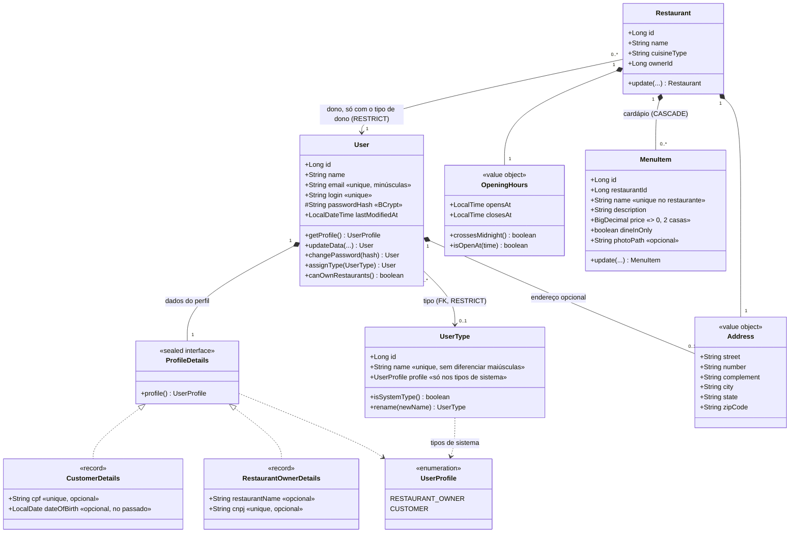

# Sistema de Gestão de Restaurantes

[](https://github.com/mikaelapg/restaurant-management/actions/workflows/ci.yml)

API REST para o sistema compartilhado de gestão de restaurantes do Tech Challenge da
pós-graduação em Arquitetura e Desenvolvimento Java (FIAP POSTECH).

**Autora:** Mikaela Perez Guedes

- **Fase 1:** cadastro e manutenção dos dois perfis de usuário, dono de restaurante e
  cliente, com validação de credenciais, busca por nome e troca de senha em endpoint dedicado.
- **Fase 2:** cadastro de tipos de usuário e associação dos usuários a um tipo, cadastro de
  restaurantes e cadastro dos itens do cardápio. Todo o projeto, inclusive o cadastro de
  usuários da Fase 1, segue a Clean Architecture.

Construída em Java 21 e Spring Boot 3.3, com persistência em PostgreSQL versionada por
Flyway e empacotamento em Docker.

**Repositório:** <https://github.com/mikaelapg/restaurant-management>
O repositório contém o código-fonte, este README, a documentação Swagger/OpenAPI (servida
pela aplicação) e a coleção Postman em JSON.

**Vídeo de apresentação:** _link a incluir_

## Stack

| Componente | Versão | Papel |
|---|---|---|
| Java | 21 (LTS) | Linguagem |
| Spring Boot | 3.3.5 | Framework da aplicação |
| Spring Data JPA | 3.3.x | Persistência e repositórios |
| PostgreSQL | 16 | Banco relacional |
| Flyway | 10.x | Versionamento do schema |
| SpringDoc OpenAPI | 2.6.0 | Especificação OpenAPI e Swagger UI |
| spring-security-crypto | 6.x | Hash BCrypt das senhas |
| Lombok | 1.18.x | Redução de boilerplate na infraestrutura |
| JUnit 5 + Mockito | 5.x | Testes unitários |
| Testcontainers | 1.20.x | Testes de integração contra PostgreSQL real |
| JaCoCo | 0.8.x | Cobertura de código, com mínimo de 80% |
| Docker Compose | v2 | Orquestração de aplicação e banco |

## Arquitetura

O código segue a Clean Architecture, em três camadas. A regra é que as dependências
apontam só para dentro: a infraestrutura conhece a aplicação, que conhece o domínio, e
nunca o contrário.

```
            ┌───────────────────────────────────────────────────────┐
            │ infrastructure  (Spring, JPA, HTTP, BCrypt)           │
            │   web/          controllers, DTOs, erros RFC 7807     │
            │   persistence/  entidades JPA, repositórios, gateways │
            │   security/     hash de senha com BCrypt              │
            │   config/       registra os casos de uso como beans   │
            │   ┌───────────────────────────────────────────────┐   │
            │   │ core/application  (Java puro)                 │   │
            │   │   casos de uso, interfaces de gateway,        │   │
            │   │   comandos, exceções, paginação               │   │
            │   │   ┌───────────────────────────────────────┐   │   │
            │   │   │ core/domain  (Java puro)              │   │   │
            │   │   │   User, UserType, Restaurant,         │   │   │
            │   │   │   MenuItem, Address, OpeningHours     │   │   │
            │   │   └───────────────────────────────────────┘   │   │
            │   └───────────────────────────────────────────────┘   │
            └───────────────────────────────────────────────────────┘
```

| Camada | Pacote | O que tem | Depende de |
|---|---|---|---|
| Domínio | `core.domain` | Entidades imutáveis que validam as próprias regras (nome obrigatório, preço positivo, horários diferentes, tipo compatível com o perfil) | nada |
| Aplicação | `core.application` | Um caso de uso por operação (`CreateRestaurantUseCase`, `AssignUserTypeUseCase`, `ChangePasswordUseCase`…) e as interfaces que eles usam (`UserGateway`, `RestaurantGateway`, `PasswordHasher`…) | domínio |
| Infraestrutura | `infrastructure` | Controllers REST, entidades JPA separadas das de domínio, gateways que implementam as interfaces da aplicação, BCrypt e classes `@Configuration` que montam os casos de uso | aplicação e domínio |

Os casos de uso e as entidades de domínio não têm nenhuma anotação do Spring nem do JPA. Por
isso são testados com JUnit e Mockito puros, sem subir contexto; trocar o banco mudaria só
os gateways, e trocar o BCrypt mudaria só o `BCryptPasswordHasher`.

**O caminho de uma requisição**, cadastrando um restaurante:

1. `RestaurantController` recebe o `RestaurantRequest`, que o Bean Validation confere
   (campos ausentes viram 400 com `fieldErrors`).
2. O request vira um `RestaurantCommand`; endereço e horário viram os objetos de valor
   `Address` e `OpeningHours`, que validam as regras de domínio.
3. `CreateRestaurantUseCase` cria o `Restaurant` e pede à `RestaurantOwnerPolicy` que
   confira o dono: ele precisa existir (404) e ter o tipo "Dono de Restaurante" (422).
4. `RestaurantJpaGateway` converte o domínio em `RestaurantJpaEntity`, salva pelo Spring
   Data e converte o resultado de volta.
5. O controller devolve `201 Created` com o header `Location` e o `RestaurantResponse`.

**Um conjunto de casos de uso para os dois perfis de usuário.** Clientes e donos
compartilham os casos de uso (`CreateUserUseCase`, `UpdateUserUseCase`,
`ChangePasswordUseCase`…). O perfil vem dos dados do comando (`CustomerDetails` ou
`RestaurantOwnerDetails`) ou é passado pelo controller: `CustomerController` sempre pede
`CUSTOMER`, então um id de dono responde 404 em `/customers/{id}`.

## Decisões de projeto

### Tipos de usuário e quem pode ser dono de restaurante

**Tipo de usuário como cadastro, associado por chave estrangeira.** Com banco relacional, a
associação é uma coluna `users.user_type_id` com FK para `user_types`. Cada usuário tem um
tipo; trocar de tipo é um `PUT /api/v1/users/{id}/user-type`.

**Dois tipos de sistema, ligados aos perfis.** As migrations cadastram "Dono de
Restaurante" e "Cliente", e a coluna `user_types.profile` liga cada um a um perfil
(`RESTAURANT_OWNER` ou `CUSTOMER`). Os cadastros novos nascem com o tipo de sistema do seu
perfil. É essa ligação, e não o nome, que o sistema usa; por isso os tipos de sistema podem
ser renomeados, mas não excluídos (409). Os tipos criados pela API não têm perfil.

**Só quem tem o tipo "Dono de Restaurante" pode ser dono de um restaurante.** É o que
distingue, na prática, os dois tipos do enunciado. Cadastrar ou atualizar um restaurante
com um cliente como dono responde 422, com uma mensagem que diz o tipo atual do usuário.

**O cadastro de tipos e o de perfis não se contradizem.** Três regras mantêm os dois
coerentes:

| Regra | Resposta |
|---|---|
| Um tipo de sistema só vai para usuários do mesmo perfil ("Cliente" não pode ser dado a um dono) | 422 `incompatible-user-type` |
| Quem é dono de restaurantes não pode perder o tipo de dono | 409 `user-type-change-not-allowed` |
| Tipos de sistema não podem ser excluídos | 409 `system-user-type` |

Tipos criados pela API (ex.: "Gerente") podem ser dados a qualquer usuário. O perfil diz
quais dados próprios o usuário tem (CPF ou CNPJ) e não muda; o tipo é o cadastro gerenciado
pelo CRUD.

### Domínio e persistência

**Usuário com composição no domínio e herança no banco.** No domínio, o `User` guarda os
dados próprios do perfil num `ProfileDetails`, uma interface selada com duas implementações
(`CustomerDetails` e `RestaurantOwnerDetails`): o compilador obriga a tratar os dois casos.
No banco, a herança `JOINED` mantém os campos comuns em `users` e os específicos em tabelas
filhas, preservando as restrições de integridade em cada coluna. O `UserJpaMapper`, na
infraestrutura, traduz entre os dois.

**Entidades imutáveis.** Toda alteração (`update`, `rename`, `assignType`,
`changePassword`) devolve uma nova instância, que passa outra vez pelas validações. Nenhuma
entidade chega a existir em estado inválido.

**Integridade garantida pelo banco e explicada pela aplicação.** O banco recusa excluir um
tipo em uso, um usuário que é dono de restaurante (`ON DELETE RESTRICT`), um preço não
positivo, horários iguais e um segundo tipo de sistema para o mesmo perfil. A aplicação
confere as mesmas regras antes, para responder 409 ou 422 com uma mensagem que diz o que
fazer, e não o erro genérico de integridade.

**Horário de funcionamento que atravessa a meia-noite.** `OpeningHours` guarda abertura e
fechamento (`HH:mm`). Fechamento antes da abertura é válido e significa que o restaurante
vira a noite (18:00 às 02:00). Abertura igual ao fechamento é recusada, porque não dá para
saber se o restaurante nunca abre ou nunca fecha.

**Itens do cardápio aninhados ao restaurante.** As rotas são
`/restaurants/{restaurantId}/menu-items`: o item não existe fora de um restaurante, e um item
de outro restaurante responde 404 pelo caminho errado. O nome é único dentro do restaurante,
sem diferenciar maiúsculas, e restaurantes diferentes podem ter pratos de mesmo nome.
Excluir o restaurante exclui o cardápio dele (`ON DELETE CASCADE`).

**Preço em `BigDecimal`.** Valores monetários não usam ponto flutuante. O preço é positivo,
tem no máximo duas casas decimais e é guardado em `NUMERIC(10, 2)`.

**Foto como caminho.** Como o enunciado permite, o item guarda só o caminho de onde a foto
estaria (`photoPath`), sem upload de arquivo.

**Paginação sem depender do Spring no núcleo.** Casos de uso e gateways trabalham com
`PageQuery` e `PageResult`, da camada de aplicação; a conversão para `Pageable` e `Page`
acontece só nos gateways JPA.

### API

**Versionamento pela URI.** A versão faz parte do caminho (`/api/v1/...`). É explícito no
endereço, testável direto no navegador e no Postman, e permite que uma futura `v2` conviva
com a `v1` sem quebrar consumidores.

**Erros no padrão RFC 7807.** Todas as respostas de erro são `application/problem+json`,
com `type` identificando a classe do problema de forma estável e legível por máquina. Erros
de validação incluem o mapa `fieldErrors`, apontando cada campo recusado. As exceções nascem
no núcleo sem saber de HTTP; só o `GlobalExceptionHandler` as traduz em status.

**Precedência explícita entre os tratadores de exceção.** Com
`spring.mvc.problemdetails.enabled`, o Spring registra o seu próprio
`ProblemDetailsExceptionHandler` com ordem 0. O `GlobalExceptionHandler` declara
`@Order(HIGHEST_PRECEDENCE)` para responder antes dele às exceções padrão do MVC. O
tratamento genérico de `Exception` fica isolado em `UnhandledExceptionHandler`, com a menor
precedência, para não transformar em 500 respostas que o Spring resolve corretamente, como
415 e 406.

**Troca de senha separada da atualização cadastral.** `PUT` não recebe senha; a troca exige
a senha atual e a confirmação da nova, em `PATCH .../password`.

**Senhas com BCrypt, sem a stack de filtros do Spring Security.** O escopo é a validação de
credenciais, não a proteção das rotas. O `BCryptPasswordHasher` usa só o
`spring-security-crypto`, por trás da interface `PasswordHasher` da aplicação. A regra de
senha forte mora no domínio (`PasswordPolicy`) e é a mesma usada pela anotação
`@StrongPassword` dos DTOs.

## Como executar

### Docker Compose

```bash
cp .env.example .env
docker compose up -d --build
docker compose logs -f app
```

O Compose sobe o PostgreSQL 16 e a aplicação. O container da aplicação só inicia após o
healthcheck do banco passar, e o Flyway cria o schema na primeira subida e aplica as
migrations novas nas seguintes.

### Local, com o Maven Wrapper

Requer um PostgreSQL acessível em `localhost:5432`. O caminho mais curto é subir apenas o
banco:

```bash
docker compose up -d db

./mvnw spring-boot:run     # Linux e macOS
.\mvnw.cmd spring-boot:run # Windows
```

### Variáveis de ambiente

| Variável | Padrão | Uso |
|---|---|---|
| `POSTGRES_DB` | `restaurant_db` | Nome do banco |
| `POSTGRES_USER` | `restaurant_user` | Usuário do banco |
| `POSTGRES_PASSWORD` | `restaurant_pass` | Senha do banco |
| `SERVER_PORT` | `8080` | Porta exposta pela API |

## Documentação da API

Com a aplicação no ar:

| Recurso | URL |
|---|---|
| Swagger UI | http://localhost:8080/swagger-ui.html |
| OpenAPI (JSON) | http://localhost:8080/api-docs |

## Endpoints

### Tipos de usuário

| Método | Caminho | Descrição |
|---|---|---|
| POST | `/api/v1/user-types` | Cadastra; nome único sem diferenciar maiúsculas |
| GET | `/api/v1/user-types` | Lista todos, em ordem alfabética |
| GET | `/api/v1/user-types/{id}` | Busca por id |
| PUT | `/api/v1/user-types/{id}` | Renomeia; vale também para os tipos de sistema |
| DELETE | `/api/v1/user-types/{id}` | Exclui; recusado (409) se for tipo de sistema ou se algum usuário tiver o tipo |
| PUT | `/api/v1/users/{id}/user-type` | Associa o usuário a um tipo: `{"userTypeId": 1}` |

```json
{ "id": 1, "name": "Dono de Restaurante", "systemType": true, "profile": "RESTAURANT_OWNER" }
```

### Restaurantes

| Método | Caminho | Descrição |
|---|---|---|
| POST | `/api/v1/restaurants` | Cadastra; o dono precisa ter o tipo "Dono de Restaurante" |
| GET | `/api/v1/restaurants` | Lista paginada, com filtros opcionais `?name=` e `?cuisineType=` |
| GET | `/api/v1/restaurants/{id}` | Busca por id |
| PUT | `/api/v1/restaurants/{id}` | Atualiza todos os dados, inclusive o dono |
| DELETE | `/api/v1/restaurants/{id}` | Exclui, junto com o cardápio |

```json
{
  "name": "Cantina da Nonna",
  "address": {
    "street": "Rua Augusta", "number": "1500", "complement": "Loja 2",
    "city": "São Paulo", "state": "SP", "zipCode": "01305-100"
  },
  "cuisineType": "Italiana",
  "openingHours": { "opensAt": "18:00", "closesAt": "02:00" },
  "ownerId": 1
}
```

### Cardápio

| Método | Caminho | Descrição |
|---|---|---|
| POST | `/api/v1/restaurants/{restaurantId}/menu-items` | Cadastra um item |
| GET | `/api/v1/restaurants/{restaurantId}/menu-items` | Lista paginada do cardápio |
| GET | `/api/v1/restaurants/{restaurantId}/menu-items/{itemId}` | Busca um item |
| PUT | `/api/v1/restaurants/{restaurantId}/menu-items/{itemId}` | Atualiza um item |
| DELETE | `/api/v1/restaurants/{restaurantId}/menu-items/{itemId}` | Exclui um item |

```json
{
  "name": "Risoto de cogumelos",
  "description": "Arroz arbóreo, funghi secchi e parmesão",
  "price": 68.90,
  "dineInOnly": false,
  "photoPath": "/images/restaurants/1/risoto.jpg"
}
```

### Autenticação

| Método | Caminho | Descrição |
|---|---|---|
| POST | `/api/v1/auth/login` | Valida login e senha |

### Clientes

| Método | Caminho | Descrição |
|---|---|---|
| POST | `/api/v1/customers` | Cadastra; nasce com o tipo "Cliente" |
| GET | `/api/v1/customers` | Lista paginada, com filtro opcional `?name=` |
| GET | `/api/v1/customers/{id}` | Busca por id |
| PUT | `/api/v1/customers/{id}` | Atualiza dados cadastrais |
| PATCH | `/api/v1/customers/{id}/password` | Troca a senha |
| DELETE | `/api/v1/customers/{id}` | Exclui |

### Donos de restaurante

| Método | Caminho | Descrição |
|---|---|---|
| POST | `/api/v1/restaurant-owners` | Cadastra; nasce com o tipo "Dono de Restaurante" |
| GET | `/api/v1/restaurant-owners` | Lista paginada, com filtro opcional `?name=` |
| GET | `/api/v1/restaurant-owners/{id}` | Busca por id |
| PUT | `/api/v1/restaurant-owners/{id}` | Atualiza dados cadastrais |
| PATCH | `/api/v1/restaurant-owners/{id}/password` | Troca a senha |
| DELETE | `/api/v1/restaurant-owners/{id}` | Exclui; recusado (409) se ainda tiver restaurantes |

### Usuários

| Método | Caminho | Descrição |
|---|---|---|
| GET | `/api/v1/users` | Lista paginada de clientes e donos juntos, com filtros `?name=` e `?profile=` |
| GET | `/api/v1/users/{id}` | Busca qualquer usuário por id |

Toda resposta de usuário traz o `profile` (`CUSTOMER` ou `RESTAURANT_OWNER`) e o
`userType`, o tipo associado (`{"id": 2, "name": "Cliente", "systemType": true, ...}`).
A senha nunca sai na resposta.

### Paginação

Todas as listagens recebem `page` e `size` e devolvem em ordem alfabética de nome.

| Parâmetro | Padrão | Observação |
|---|---|---|
| `page` | `0` | Índice da página, base zero |
| `size` | `20` | Itens por página; máximo `100` |

A resposta é um envelope: `content` (a página de itens) mais os metadados `page`, `size`,
`totalElements`, `totalPages` e `last`. A lista de tipos de usuário não é paginada: é uma
tabela de referência com poucas linhas.

## Regras de validação e unicidade

### Usuários

| Campo | Regra |
|---|---|
| `name` | Obrigatório, de 2 a 255 caracteres |
| `email` | Obrigatório, formato válido, único entre todos os usuários, normalizado para minúsculas |
| `login` | Obrigatório, de 3 a 100 caracteres, único independente de maiúsculas e minúsculas |
| `password` | Obrigatório, de 8 a 72 caracteres com minúscula, maiúscula, dígito e caractere especial, sem espaços; armazenado como hash BCrypt (custo 12) |
| `address` | Opcional; quando informado, `street`, `number`, `city`, `state` e `zipCode` são obrigatórios |
| `cpf` | Opcional; quando informado, formato `000.000.000-00` e único |
| `cnpj` | Opcional; quando informado, formato `00.000.000/0000-00` e único |
| `dateOfBirth` | Opcional; quando informada, deve estar no passado |

E-mail e login são únicos no conjunto de todos os usuários, não por perfil, e comparados sem
diferenciar a caixa: o login é a credencial do serviço de validação e precisa identificar
um único usuário. Na atualização, o endereço ausente no corpo significa manter o atual, não
apagá-lo.

### Tipos de usuário, restaurantes e cardápio

| Recurso | Campo | Regra |
|---|---|---|
| Tipo de usuário | `name` | Obrigatório, até 50 caracteres, único sem diferenciar maiúsculas |
| Restaurante | `name` | Obrigatório, até 100 caracteres |
| Restaurante | `address` | Obrigatório; `street`, `number`, `city`, `state` e `zipCode` obrigatórios, `complement` opcional |
| Restaurante | `cuisineType` | Obrigatório, até 50 caracteres |
| Restaurante | `openingHours` | `opensAt` e `closesAt` obrigatórios (`HH:mm`) e diferentes; fechamento antes da abertura significa que vira a noite |
| Restaurante | `ownerId` | Obrigatório; precisa ser um usuário existente com o tipo "Dono de Restaurante" |
| Item do cardápio | `name` | Obrigatório, até 100 caracteres, único no restaurante sem diferenciar maiúsculas |
| Item do cardápio | `description` | Obrigatória, até 500 caracteres |
| Item do cardápio | `price` | Obrigatório, maior que zero, até duas casas decimais |
| Item do cardápio | `dineInOnly` | Obrigatório; `true` quando o item só pode ser pedido para consumo no restaurante |
| Item do cardápio | `photoPath` | Opcional, até 500 caracteres |

As regras valem duas vezes: no DTO, para a API responder 400 com `fieldErrors` por campo, e
na entidade de domínio, que se protege sozinha mesmo quando usada fora da camada web.

## Modelo de erros

```json
{
  "type": "https://restaurant-api.com/errors/invalid-restaurant-owner",
  "title": "Usuário Não É Dono de Restaurante",
  "status": 422,
  "detail": "O usuário 2 não pode ser dono de restaurante: é preciso ter o tipo de usuário de dono de restaurante, e o tipo atual dele é 'Cliente'.",
  "instance": "/api/v1/restaurants",
  "timestamp": "2026-10-22T13:00:00Z"
}
```

| Status | `type` | Situação |
|---|---|---|
| 400 | `validation-error` | Bean Validation recusou campos; inclui `fieldErrors` |
| 400 | `domain-validation` | Uma regra de entidade de domínio foi violada, como horários de abertura e fechamento iguais |
| 400 | `malformed-json` | Corpo ausente, JSON malformado ou valor em formato inválido (ex.: horário `25:00`) |
| 400 | `invalid-parameter` | Parâmetro de caminho ou query com tipo incompatível |
| 401 | `invalid-credentials` | Login inexistente ou senha incorreta |
| 404 | `user-not-found` | Nenhum usuário com o id informado (ou de outro perfil, nas rotas de cliente e de dono) |
| 404 | `user-type-not-found` | Nenhum tipo de usuário com o id informado |
| 404 | `restaurant-not-found` | Nenhum restaurante com o id informado |
| 404 | `menu-item-not-found` | O item não existe no cardápio do restaurante informado |
| 404 | `resource-not-found` | Rota inexistente |
| 405 | `method-not-allowed` | Método HTTP não suportado pelo endpoint |
| 409 | `email-conflict` | E-mail já cadastrado |
| 409 | `login-conflict` | Login já cadastrado |
| 409 | `cpf-conflict` | CPF já cadastrado |
| 409 | `cnpj-conflict` | CNPJ já cadastrado |
| 409 | `user-type-conflict` | Já existe um tipo de usuário com o nome |
| 409 | `user-type-in-use` | Exclusão de tipo de usuário associado a usuários |
| 409 | `system-user-type` | Exclusão de um tipo de sistema |
| 409 | `user-type-change-not-allowed` | Tirar o tipo de dono de quem tem restaurantes |
| 409 | `user-owns-restaurants` | Exclusão de usuário que é dono de restaurantes |
| 409 | `menu-item-conflict` | O restaurante já tem um item com o nome |
| 409 | `data-integrity-conflict` | Violação de restrição do banco não coberta acima |
| 422 | `invalid-password` | Senha atual incorreta, ou confirmação divergente |
| 422 | `invalid-restaurant-owner` | O dono informado não tem o tipo "Dono de Restaurante" |
| 422 | `incompatible-user-type` | Tipo de sistema de outro perfil (ex.: "Cliente" para um dono) |
| 500 | `internal-error` | Falha não prevista |

A distinção entre 401, 409 e 422 é intencional: 401 responde a quem não provou identidade
no login; 409, a um conflito com o estado atual (algo que já existe ou depende do recurso);
422, a um pedido bem formado cuja regra de negócio falhou.

## Banco de dados

O schema é criado e evoluído pelo Flyway, em `src/main/resources/db/migration`:

| Migration | O que faz |
|---|---|
| `V1__create_tables.sql` | Usuários: `users`, `customers`, `restaurant_owners` |
| `V2__create_user_types.sql` | Tabela `user_types`, com índice único sobre `LOWER(name)` |
| `V3__associate_users_with_user_types.sql` | Coluna `users.user_type_id`, os tipos "Dono de Restaurante" e "Cliente" e a associação dos usuários existentes |
| `V4__create_restaurants.sql` | Tabela `restaurants` |
| `V5__create_menu_items.sql` | Tabela `menu_items` |
| `V6__link_system_user_types_to_profiles.sql` | Coluna `user_types.profile`, que liga os tipos de sistema aos perfis, e ajuste dos dados antigos às regras novas |

| Tabela | Colunas |
|---|---|
| `users` | `id`, `user_type` (discriminador do perfil), `user_type_id` (FK para `user_types`), `name`, `email` (único), `login` (único), `password`, `last_modified_at`, e o endereço embutido: `street`, `number`, `complement`, `city`, `state`, `zip_code` |
| `customers` | `id` (FK para `users`), `cpf` (único), `date_of_birth` |
| `restaurant_owners` | `id` (FK para `users`), `restaurant_name`, `cnpj` (único) |
| `user_types` | `id`, `name` (único sem diferenciar maiúsculas), `profile` (único; só nos tipos de sistema) |
| `restaurants` | `id`, `name`, `cuisine_type`, `opens_at`, `closes_at`, `owner_id` (FK para `users`), e o endereço embutido |
| `menu_items` | `id`, `restaurant_id` (FK para `restaurants`), `name` (único por restaurante sem diferenciar maiúsculas), `description`, `price` (`NUMERIC(10, 2)`), `dine_in_only`, `photo_path` |

| Chave estrangeira | Ao excluir o referenciado |
|---|---|
| `customers.id`, `restaurant_owners.id` → `users` | `CASCADE`: os dados do perfil saem junto |
| `users.user_type_id` → `user_types` | `RESTRICT`: tipo em uso não pode ser excluído |
| `restaurants.owner_id` → `users` | `RESTRICT`: dono de restaurante não pode ser excluído |
| `menu_items.restaurant_id` → `restaurants` | `CASCADE`: o cardápio sai junto com o restaurante |

Restrições `CHECK` impõem no banco que `opens_at <> closes_at`, que `price > 0` e que
`user_types.profile` seja um perfil válido. `last_modified_at` é mantido pelo Hibernate via
`@UpdateTimestamp`.

### Modelo de domínio



Fontes do diagrama: [`docs/domain-model.mmd`](docs/domain-model.mmd) (Mermaid) e
[`docs/domain-model.puml`](docs/domain-model.puml) (PlantUML).

## Testes

```bash
./mvnw test      # 239 testes unitários (JUnit 5 + Mockito) e relatório do JaCoCo
./mvnw verify    # + 26 testes de integração com Testcontainers (exige Docker) e checagem de cobertura
```

**Testes unitários**, sem banco e sem subir a aplicação:

- Domínio: `UserTest`, `ProfileDetailsTest`, `UserTypeTest`, `RestaurantTest`,
  `OpeningHoursTest`, `AddressTest`, `MenuItemTest` — as regras de cada entidade e objeto
  de valor
- Casos de uso, com os gateways mockados: `UserUseCasesTest`, `UserTypeUseCasesTest`,
  `RestaurantUseCasesTest`, `MenuItemUseCasesTest`, `PaginationTest`
- Infraestrutura: `UserJpaGatewayTest` e `JpaGatewaysTest` (conversão entre domínio e JPA,
  ordenação e paginação, com os repositórios mockados), `BCryptPasswordHasherTest` e
  `ConfigTest`
- Camada web, com `@WebMvcTest`: um teste por controller — rotas, status, JSON e corpo de
  erro RFC 7807
- Tratamento de erros: `GlobalExceptionHandlerTest`, `UnhandledExceptionHandlerTest`

**Testes de integração** (sufixo `IT`, rodam em `mvn verify` pelo maven-failsafe-plugin):
sobem um PostgreSQL 16 real com Testcontainers e exercitam a aplicação de ponta a ponta,
do HTTP ao banco.

| Classe | O que prova |
|---|---|
| `SchemaConstraintsIT` | Todas as migrations aplicam, o Hibernate valida o schema e as constraints valem no banco |
| `UserApiIT` | Ciclo de vida de clientes e donos, login, separação entre perfis e conflitos |
| `UserTypeApiIT` | Tipos de sistema, CRUD de tipos, associação, tipo em uso e tipo de outro perfil |
| `RestaurantApiIT` | CRUD de restaurantes, filtros e paginação, cliente como dono, dono que não pode ser excluído nem perder o tipo, e `CHECK` de horário |
| `MenuItemApiIT` | CRUD do cardápio, unicidade por restaurante, isolamento entre restaurantes, cascata e constraints de preço |

Sem Docker disponível, as classes de integração são ignoradas sem quebrar o build.

**Cobertura** pelo JaCoCo (relatório em `target/site/jacoco/index.html` após `mvn test`):
99,4% das linhas na suíte unitária. O `mvn verify` falha se a cobertura de linhas ficar
abaixo de 80%.

**Integração contínua.** O GitHub Actions (`.github/workflows/ci.yml`) roda o
`mvn verify` completo a cada push e pull request, com os testes de integração contra
PostgreSQL, e publica a cobertura e os relatórios de teste. O código gerado pelo Lombok
fica fora da conta (`lombok.config`).

## Coleção Postman

```bash
newman run postman/restaurant-management.postman_collection.json
```

As pastas estão numeradas na ordem de execução, porque cada uma depende do que a anterior
cadastrou:

1. Cadastro de usuários
2. Validação de login
3. Busca de usuários
4. Atualização de dados
5. Troca de senha
6. Tipos de usuário: CRUD, tipos de sistema, associação e tipo de outro perfil
7. Restaurantes: CRUD, filtros, cliente como dono e dono que não pode ser excluído nem perder o tipo
8. Cardápio: CRUD, nome repetido, preço inválido e exclusão em cascata
9. Exclusão de usuários

Os ids são capturados dos próprios cadastros, e cada execução gera e-mails, logins, CPF,
CNPJ e nomes distintos — a coleção pode rodar várias vezes no mesmo banco sem esbarrar nas
restrições de unicidade. São 73 requisições e 160 asserções, cobrindo os cenários de
sucesso e de erro.

## Estrutura

```
src/main/java/com/restaurant/management
├── core                          Java puro, sem Spring nem JPA
│   ├── domain
│   │   ├── exception             DomainValidationException, IncompatibleUserTypeException
│   │   ├── shared                Address (objeto de valor)
│   │   ├── user                  User, ProfileDetails, CustomerDetails,
│   │   │                         RestaurantOwnerDetails, UserProfile, PasswordPolicy
│   │   ├── usertype              UserType
│   │   ├── restaurant            Restaurant, OpeningHours
│   │   └── menuitem              MenuItem
│   └── application
│       ├── exception             Exceções dos casos de uso (não encontrado, conflito, regra)
│       ├── pagination            PageQuery, PageResult
│       ├── auth                  AuthenticateUserUseCase
│       ├── user                  Casos de uso, UserGateway, PasswordHasher, comandos
│       ├── usertype              Casos de uso e UserTypeGateway
│       ├── restaurant            Casos de uso, RestaurantGateway, RestaurantOwnerPolicy
│       └── menuitem              Casos de uso, MenuItemGateway e MenuItemCommand
└── infrastructure                Adaptadores
    ├── config                    Casos de uso como beans e OpenAPI
    ├── persistence               Entidades JPA, repositórios Spring Data e gateways
    ├── security                  BCryptPasswordHasher
    └── web                       Controllers REST, DTOs e tratamento de erros RFC 7807
```
